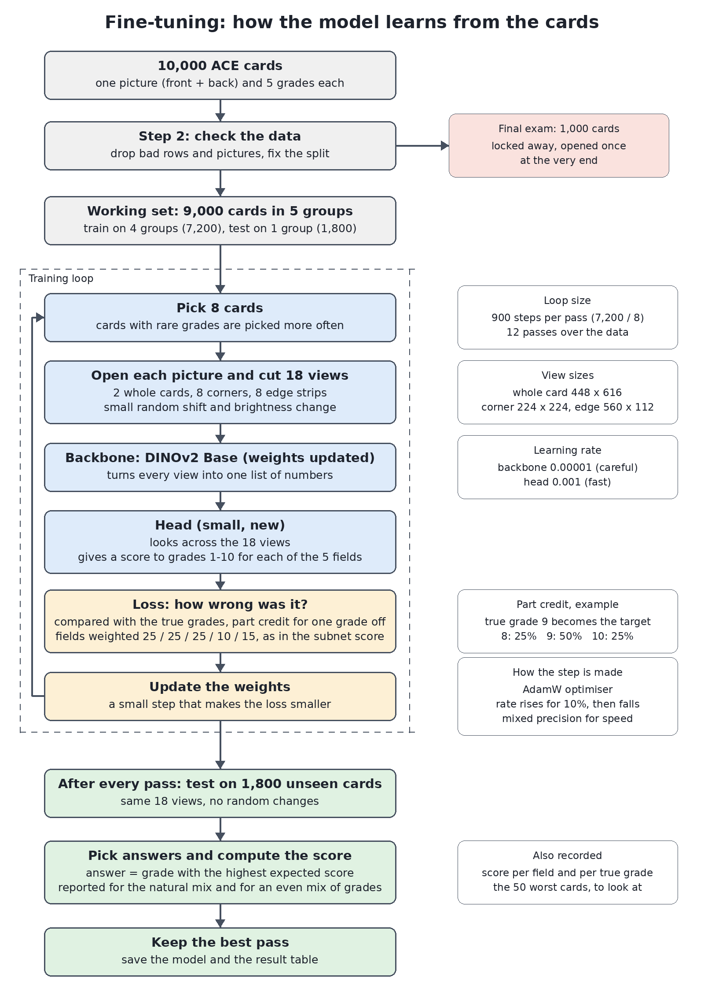
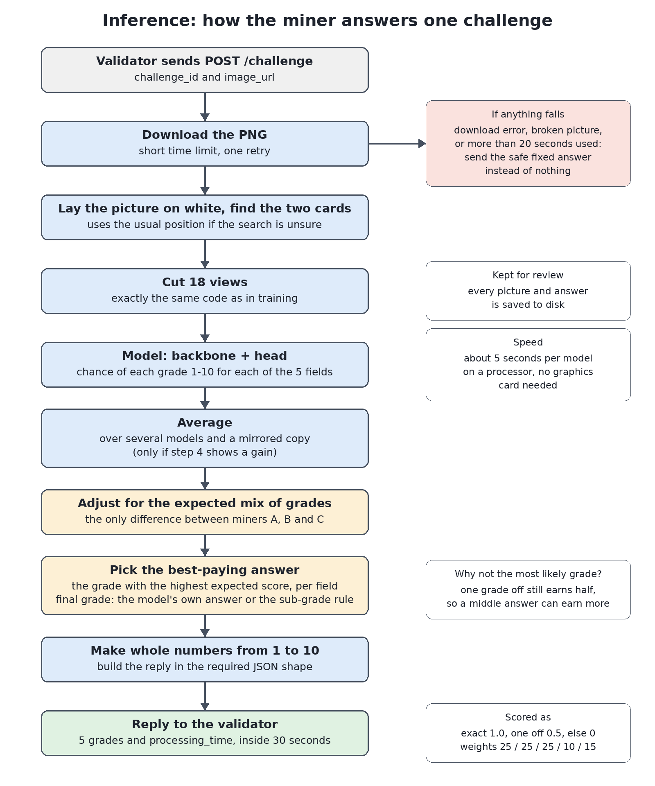

# AI ACE Card Grader

A model that grades trading cards the way ACE Grading does: from one picture showing the front
and back of a card in its case, it predicts the four sub-grades (surface, edges, corners,
centering) and the final grade, each from 1 to 10.

It is built for the card-grading challenge of Score, subnet 44 of the Bittensor network,
whose scoring rule it follows: for each of the five values, 1.0 for an exact answer and 0.5
for one grade off, weighted 25 / 25 / 25 / 10 / 15.

**All rights reserved. This code is published for viewing only; see [LICENSE](LICENSE).**

## How it works

1. **18 views per card.** The front and back are found in the picture and cut into the two
   whole sides, 8 corner close-ups and 8 edge close-ups, at nearly full sharpness, because
   whitening and chipping are only a few pixels wide (`grader/views.py`).
2. **One pre-trained vision model reads every view.** DINOv2 Base, with all its weights
   trained further on graded cards (`grader/model.py`).
3. **A small attention head** turns the 18 view descriptions into the five grades. With
   `--own-views`, corners and edges are judged only from their own close-ups, so the model
   cannot guess them from how old the card looks.
4. **Training with part credit.** The target gives partial weight to neighbouring grades,
   as the score does, and rare low grades are shown more often (`grader/train.py`).
5. **The answer with the highest expected score** is returned, not the most likely grade
   (`grader/scoring.py`).

## Results so far

Measured on 3,050 graded cards that the model never trained on (17,207 cards in all).

| Answer method | Score | Score with every grade counted equally |
|---|---|---|
| Always answer 10 | 0.746 | 0.304 |
| Knowing only the card's release year and type | 0.772 | – |
| Pre-trained model, frozen | 0.788 | 0.556 |
| **Fine-tuned model** | **0.82** | **0.64 to 0.66** |
| Average of three fine-tuned models | 0.830 | 0.661 |

- Edges and corners are well learned (0.86 to 0.88). Surface, where scratches can be thinner
  than a pixel, is the weakest part (about 0.68).
- The score still rises with more training cards: 0.775, 0.787, 0.802 and 0.812 for 1,000,
  2,500, 5,000 and 12,375 cards.

## What is in this repository

| Folder | Contents |
|---|---|
| `grader/` | Data checks, views, model, training, scoring and reports |
| `ops/` | Scripts to prepare a server, rent a graphics card on Vast.ai, upload, train unattended and stop the machine |
| `docs/` | The two diagrams above |

Not included: the card pictures and grades, the trained models, and the pre-trained weights.
